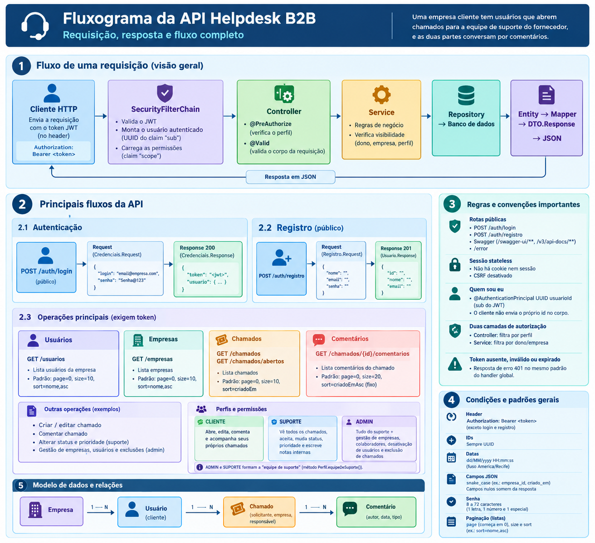

# Help Desk API (B2B)

Sistema de chamados de suporte para empresas que atendem outras empresas. Centraliza o atendimento técnico entre fornecedores de serviços e os seus clientes corporativos: a empresa cliente registra e acompanha as solicitações, e a equipe de suporte assume os chamados, define prioridades, atualiza status e mantém o histórico das interações.

- modules: reúne os módulos funcionais e suas respectivas regras de negócio.
- common: contém componentes compartilhados entre os módulos.
- infra: concentra configurações técnicas e de segurança.

## Para quem é

Para empresas de pequeno e médio porte que prestam suporte técnico, manutenção ou atendimento a clientes corporativos e ainda controlam isso de forma manual. O objetivo é dar a elas organização e rastreabilidade sem a complexidade e o custo de uma ferramenta de grande porte.

## O que a empresa ganha

- Cada chamado tem protocolo, responsável, prioridade, prazo de resolução e histórico completo de conversa.
- A equipe enxerga uma fila de chamados abertos e assume o que vai atender, sem trabalho duplicado.
- O cliente acompanha o andamento sem precisar cobrar por mensagem.
- Notas internas permitem que a equipe registre informações que o cliente não deve ver.
- Cada cliente enxerga apenas os próprios dados. Um cliente nunca vê o chamado de outra empresa.

## Perfis de acesso

O **CLIENTE** é um funcionário de uma empresa cliente. Abre chamados, edita os seus, comenta e acompanha o andamento. Vê somente o que ele mesmo abriu.

O **SUPORTE** é a equipe do fornecedor. Vê os chamados de todas as empresas, assume chamados da fila, altera status e prioridade e escreve notas internas.

O **ADMIN** faz tudo o que o suporte faz e também gerencia empresas, colaboradores e usuários, além de excluir chamados.

## Como um chamado é atendido

1. O ADMIN cadastra a empresa cliente e a equipe de suporte.
2. Os usuários da empresa entram por auto-cadastro ou são criados por alguém já autenticado.
3. O CLIENTE abre um chamado informando título, descrição, categoria e setor. A empresa e o solicitante vêm do token, nunca do corpo da requisição.
4. O SUPORTE consulta a fila de chamados abertos e aceita um deles, tornando-se o responsável.
5. Cliente e suporte conversam por comentários. Quando o comentário é marcado como nota interna, só a equipe de suporte consegue lê-lo.
6. O SUPORTE ajusta prioridade e status até a conclusão.

O ciclo de status é ABERTO, EM_ANDAMENTO, RESOLVIDO e FECHADO, com CANCELADO como saída alternativa. Ao resolver ou fechar, a API registra a data correspondente. O prazo de resolução é calculado a partir da prioridade do chamado.

## Segurança e confiabilidade

Um sistema que guarda o atendimento de vários clientes precisa tratar bem quem vê o quê. As decisões abaixo existem por isso.

**Autorização em duas camadas.** O controller decide o que cada perfil pode chamar. O service decide o que cada usuário pode enxergar, filtrando por dono e por empresa.

**Recurso fora de alcance responde "não encontrado".** Se um cliente pedir o chamado de outra empresa, recebe o mesmo erro de um id que não existe. A API não confirma a existência de dados que o usuário não pode ver.

**Identidade vem do token.** O id de quem faz a chamada é lido do JWT. Nenhum endpoint o aceita no corpo da requisição, o que impede alguém de agir em nome de outro usuário.

**Perfil nunca é escolhido pelo usuário comum.** O auto-cadastro sempre cria um CLIENTE. Colaboradores são criados apenas pelo ADMIN.

**Sessão stateless.** Sem cookie e sem sessão no servidor. Cada requisição carrega o token, e a validação consulta o banco para barrar usuários desativados.

**Exclusão lógica.** Chamados excluídos continuam no banco e deixam de aparecer. O histórico não se perde.

**Senhas com BCrypt.** Gravadas com custo 12 e nunca devolvidas nas respostas.

**Erros padronizados.** Falhas, inclusive as de autenticação (401) e autorização (403), seguem o mesmo formato de resposta, o que facilita o tratamento no front-end.

## Tecnologias

- Java e Spring Boot
- Spring Security com JWT
- Spring Data JPA e Hibernate, com filtros dinâmicos via Specification
- PostgreSQL
- Flyway para versionamento do banco
- Bean Validation para validação das entradas
- Swagger UI e OpenAPI para documentação interativa

## Autenticação

Faça login em `POST /auth/login` com e-mail e senha. A resposta traz o token, o tipo e a data de expiração. Nas demais requisições, envie o token no cabeçalho `Authorization: Bearer <token>`.

As únicas rotas públicas são `POST /auth/login` e `POST /auth/registro`, além da documentação.

## Endpoints

**Autenticação:** `POST /auth/login`, `POST /auth/registro`

**Usuários:** `POST /usuarios/clientes`, `POST /usuarios/admin/colaboradores`, `GET /usuarios`, `GET /usuarios/{id}`, `PUT /usuarios/{id}`, `PATCH /usuarios/{id}/desativar`, `PATCH /usuarios/{id}/reativar`

**Empresas:** `POST /empresas`, `GET /empresas`, `GET /empresas/{id}`, `PUT /empresas/{id}`, `PATCH /empresas/{id}/desativar`, `PATCH /empresas/{id}/reativar`

**Chamados:** `POST /chamados`, `GET /chamados`, `GET /chamados/abertos`, `GET /chamados/{id}`, `PUT /chamados/{id}`, `PATCH /chamados/{id}/aceitar`, `PATCH /chamados/{id}/status`, `PATCH /chamados/{id}/prioridade`, `DELETE /chamados/{id}`

**Comentários:** `POST /chamados/{id}/comentarios`, `GET /chamados/{id}/comentarios`

## Convenções da API

- IDs em UUID.
- Datas no formato `dd/MM/yyyy HH:mm:ss`.
- Campos JSON em `snake_case`. Campos nulos não aparecem na resposta, então um chamado ainda sem responsável não traz os dados do responsável.
- Listas paginadas com os parâmetros `page` (começa em 0), `size` e `sort`, por exemplo `sort=nome,asc`.

## Implantação

Pré-requisitos: JDK instalado e uma instância do PostgreSQL.

1. Clone o repositório e entre na pasta do projeto.
2. Crie o banco e informe a conexão e a chave de assinatura do JWT por variáveis de ambiente ou no arquivo `application.yaml`.
3. Suba a aplicação com `./mvnw spring-boot:run`.

As migrations do Flyway criam as tabelas na primeira execução, e um usuário ADMIN inicial é criado se ainda não existir. Esse usuário serve apenas para desenvolvimento e a senha deve ser trocada em qualquer ambiente real.

Com a aplicação rodando, a documentação interativa fica em `/swagger-ui.html` e a especificação OpenAPI em `/v3/api-docs`.

## O que definir com cada cliente

Algumas regras dependem do negócio e são ajustadas caso a caso.

- **Cadastro de usuários.** Hoje o auto-cadastro exige o `empresa_id`. Para um ambiente aberto, o mais seguro é cadastro por convite ou com aprovação do administrador da empresa.
- **Quem vê o quê.** Hoje o cliente enxerga apenas os chamados que abriu. Se a equipe do cliente precisa acompanhar todos os chamados da empresa, essa regra muda.
- **Chamados encerrados.** Hoje é possível comentar em chamados fechados ou cancelados. Se o atendimento exige bloqueio, a regra entra na validação do chamado.
- **Categorias, setores e prazos.** São enums e prazos por prioridade, fáceis de adaptar ao vocabulário e aos acordos de cada empresa.

